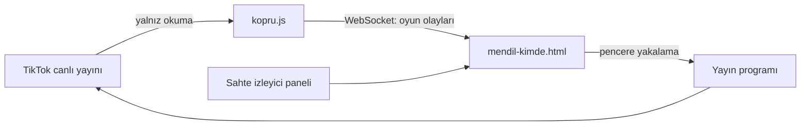

# Mimari

## Büyük resim

Oyun bir tarayıcı sayfasıdır; yayın programı (TikTok LIVE Studio, OBS) o pencereyi yayına verir. Köprü
olmadan da çalışır: o zaman olaylar paneldeki sahte izleyiciden gelir.

## Bir karede olanlar (`src/js/33-kare.js`)

1. **Saat.** `muzik.planla()` önümüzdeki 0,2 saniyenin notalarını zamanlar; `muzik.beatAt()` şu anki vuruşu
   (`B`) verir.
2. **Oyun.** Coşku söner, süresi dolan hareket ve solo biter, sessiz kalanlar çıkarılır.
3. **Hareket.** Her karakter yaydaki yerine doğru yürür (`karakterHareket`).
4. **Kamera.** Kalabalığın kapladığı alana göre uzaklık ve hedef ayarlanır.
5. **İskelet.** Her karakterin eklemleri hesaplanır (`iskelet`, sonra `kollar`).
6. **Çizim.** Zemin → gölgeler → derinliğe göre sıralı gövde parçaları → ampuller → adlar ve balonlar →
   konfeti.

## Vuruş saati (`src/js/10-muzik.js`)

Müzik "adım" adım zamanlanır (bir adım = onaltılık nota; 6/8'lik havada sekizlik). Her adım için
`{ t, beat, bd }` kaydı tutulur: adımın zamanı, vuruş numarası, o andaki vuruş süresi. `beatAt(t)` en son
kaydı bulup doğrusal ilerletir.

Ses kapalıyken zaman `performance.now()`'dan, ses açıkken `AudioContext.currentTime`'dan okunur. Geçişte
(`tabanDegistir`) eski saatte sıradaki adımın vuruşu korunur ve araya, yeni saatte o adıma tam vuruşunda
varan bir köprü kaydı konur. `beatAt` ayrıca hiçbir zaman öncekinden küçük değer döndürmez.

Tempo: `bpm × carpan`. `carpan`, coşkuya göre 1,0–1,3 arasıdır; davulcu şovunda 0,08 eklenir.

Ses zinciri: davul ve zurna → `ana` → sıkıştırıcı → `son` (ses düzeyi) → çıkış. Düzey sıkıştırıcıdan sonra
ayarlanır; böylece düzey artınca kırpılma olmaz.

## Yerleşim (`yerlesimHesapla`, `src/js/20-kurallar.js`)

Oynayanlar merkezi (0, 0) olan bir çemberin yayına, 0,54 m arayla dizilir. Yarıçap en az 2,2 m'dir; yay en
çok 5,2 radyan açılır, kalabalık bundan fazlaysa yarıçap büyür. Açı 0, kameranın tam karşısıdır (arka); yay
arkada ortalanır, açıklığı hep kameraya bakar. Halay başı yayın negatif ucundadır (ekranda sol); boşta kalan
eli mendil sallar. Kalabalık arttıkça yay öne doğru sarar ve halkaya döner.

Herkes kameraya döner, halkanın içine doğru hafifçe kırılır (`karakterHareket`): yayın neresinde durursa
dursun yüzü görünür. Bu yüzden komşunun sağda mı solda mı kaldığı konuma göre değişir; `kollar` bunu her
karede hesaplar.

Çalgıcılar (`33-kare.js`): bir avuç kişiyken dizinin iki yanında, kalabalıklaşınca yayın önünde, halka
kapanınca tam ortada durur. Solo yapan onların önüne çıkar, çalgıcılar iki yana açılır.

## Karakter (`src/js/30-iskelet.js`, `31-cizim.js`)

Karakter 15 eklemden oluşur: kalça, göğüs, baş, iki omuz, iki dirsek, iki el, iki kalça eklemi, iki diz,
iki ayak. Ayak hedefleri halay adımından (`ayakSag`, `ayakSol`; 4 vuruşluk döngü) gelir, dizler ters
kinematikle (`ik`) bulunur. Komşu iki oynayanın eli, kalçalarının orta noktasında buluşur.

Karakterler iri başlı, kısa gövdelidir (baş boyun yarısını tutar): kalabalıkta da yüzler okunur. Ölçüler
`30-iskelet.js` başındaki sabitlerdedir (`KALCA`, `KAFA_R`, `BACAK`, `KOL`).

Gövde parçaları iki ucu farklı yarıçaplı kapsüllerdir (`kap`). Baş bir dairedir; yüz hatları başın yerel
yönüne göre kaydırılır, arkadan bakınca saç ya da yazma yüzü örter (`kafaCiz`). Kamera yukarıdan baktığı
hâlde tepe değil yüz görünsün diye yüz hatları gerçek eğimin üçte biriyle yerleştirilir (`kam.bf`, `kam.bu`).

Görünüm (`gorunumUret`) izleyicinin kimliğinin özetinden üretilir: aynı kişi her yayında aynı görünür.

## Kamera ve izdüşüm

`kam`: hedef noktası, uzaklık (`D`), sabit eğim (0,62 rad), dar görüş açısı (`F` = 1400) ve çok hafif
salınan yatay açı. Dar açı, halkanın önündeki ile arkasındaki arasındaki boy farkını azaltır.
`pr([x, y, z])` noktayı 720×1280 sanal tuvale düşürür ve `{ x, y, s, d, ok }` döner: ekran konumu, metre
başına piksel, derinlik, görünür mü.

Uzaklık her karede yeniden hesaplanır (`kare`): oynayanlar, çalgıcılar ve solo yeri, sahnenin oyunculara
ayrılan şeridine (`ALAN_UST`–`ALAN_ALT`; üstü sahne yazıları, altı TikTok'un yorum alanı) sığacak kadar
uzaklaşılır. Kameraya yakın duran daha iri göründüğü için genişlikte her nokta kendi derinliğiyle sayılır.

Kamera yüksekten baktığı için gerçek ufuk görüntünün dışındadır. Gökyüzü ve köy, sahnenin üstünde sabit bir
fon perdesidir (`UFUK`, `32-dekor.js`); ampul dizileri onun önünde asılıdır. Meydanın ışığı ve kilim çevresi
oynayanları ortalar (`D.meydanR`, `kam.tz`).

## Köprü (`kopru.js`)

- HTTP: `/` oyunu sunar ve içine `window.MENDIL_KOPRU` satırını ekler; `/durum` JSON verir.
- WebSocket: el sıkışma ve çerçeveleme elle yazılmıştır (bağımlılık yok). Yalnız metin çerçevesi yollar;
  istemciden yalnız kapanış ve ping'i işler.
- Kaynak: `tiktok-live-connector` (eski sürümde `WebcastPushConnection`, yenide `TikTokLiveConnection`).
  `cevir`, iki sürümün veri biçimini de oyunun olay biçimine indirger. Bağlantı koparsa ya da yayın kapalıysa
  artan aralıklarla (15 sn → en çok 120 sn) yeniden dener.
- `--deneme`: kütüphaneyi hiç yüklemeden sahte olay üretir.
